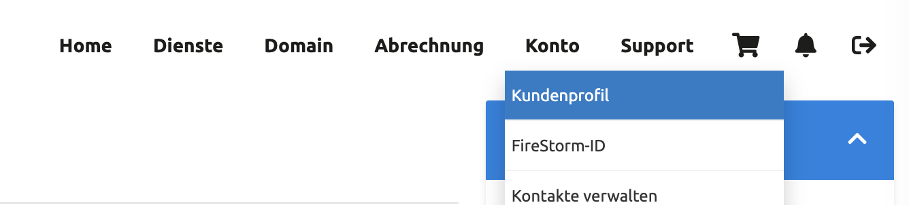
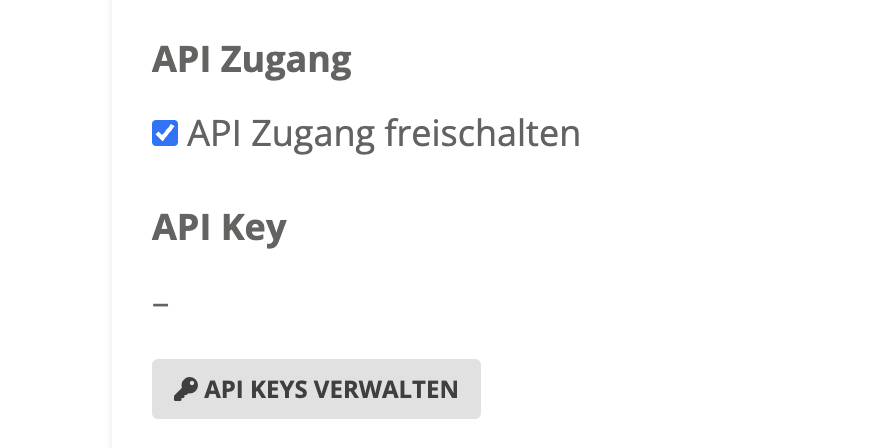
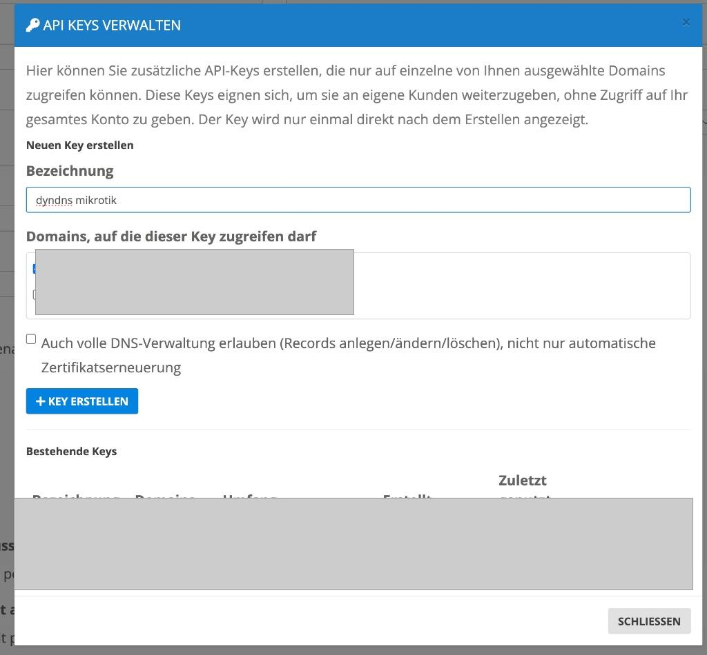
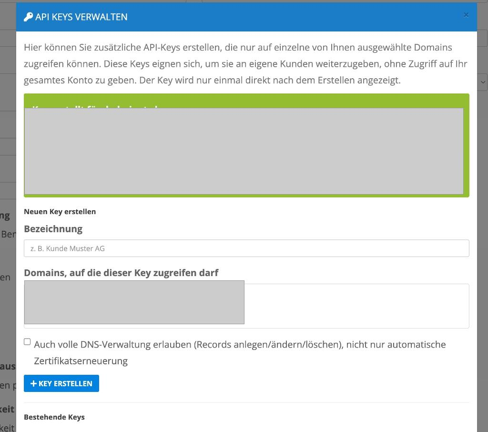

# Firestorm DynDNS Script für MikroTik RouterOS

Dieses Skript aktualisiert dynamisch die IP-Adresse eines DNS-Eintrags über die Firestorm API für MikroTik Router.

## Funktionsweise des Skripts
Das Skript ist sehr effizient und netzwerkschonend programmiert (v2 mit Quick-Check):
1. **Lokale IP-Ermittlung**: Es liest die aktuelle WAN-IP-Adresse des angegebenen Interfaces aus.
2. **Quick-Check (DNS-Resolve)**: Bevor die Firestorm API belastet wird, löst das Skript den aktuellen DNS-Eintrag über externe Resolver (Cloudflare `1.1.1.1` oder Quad9 `9.9.9.9`) auf. Stimmt die ermittelte IP bereits mit der WAN-IP überein, beendet sich das Skript sofort ohne API-Aufruf.
3. **API Fetch (Authoritative Data)**: Falls die IP abweicht, fragt das Skript per API die aktuellen Daten (insbesondere die `old_data`) der Zone bei Firestorm ab. Diese werden zwingend für das Update benötigt.
4. **API Update**: Zum Schluss sendet das Skript die neue IP-Adresse per HTTP `PUT` Request an die Firestorm API und aktualisiert so den A-Record.

---

## 1. Firestorm API Key erstellen

Um das Skript nutzen zu können, benötigen Sie einen API-User und einen API-Key von Firestorm.

1. Loggen Sie sich in Ihr Firestorm-Konto ein.
2. Navigieren Sie im oberen Menü zu **Konto > Kundenprofil**.
   
3. Aktivieren Sie den **API Zugang** durch Setzen des Häkchens und klicken Sie auf **API KEYS VERWALTEN**.
   
4. Klicken Sie auf **Neuen Key erstellen**, geben Sie eine Bezeichnung (z.B. `dyndns mikrotik`) ein und wählen Sie die Domain(s) aus, auf die dieser Key zugreifen darf. Erlauben Sie zudem die "volle DNS-Verwaltung".
   
5. **Wichtig:** Notieren Sie sich nun den **Benutzername (X-Api-User)** und den **API Key (X-Api-Key)**. Diese werden nur einmalig angezeigt!
   

---

## 2. MikroTik Script einrichten

1. Verbinden Sie sich mit Ihrem MikroTik Router (z.B. über Winbox).
2. Navigieren Sie zu **System > Scripts**.
3. Klicken Sie auf das **[+]** Symbol, um ein neues Skript zu erstellen.
4. Vergeben Sie einen Namen, z.B. `Firestorm-DynDNS`.
5. Setzen Sie die erforderlichen Berechtigungen (Policies): `read`, `write`, `policy`, `test`.
6. Fügen Sie den Inhalt vom Skript "firestorm_mikrotik_dyndns.rsc" in das Textfeld ein und passen Sie die **Variablen** im oberen Bereich an:

```routeros
# BITTE DIESE VARIABLEN ANPASSEN
:local apiUser "IHR-API-USER"
:local apiKey "IHR-API-KEY"
:local zoneId "IHRE-ZONE-ID"
:local recordName "subdomain.ihredomain.ch"
:local subDomain "subdomain"
:local recordType "A"
:local wanInterface "ethernet1" # Name Ihres WAN-Interfaces
:local ttl "60"
```
*(Den Rest des Skripts können Sie unverändert lassen)*

---

## 3. MikroTik Scheduler einrichten (Automatisierung)

Damit das Skript regelmäßig prüft, ob sich Ihre IP geändert hat, richten wir einen Scheduler ein:

1. Navigieren Sie in Winbox zu **System > Scheduler**.
2. Klicken Sie auf das **[+]** Symbol.
3. Vergeben Sie einen Namen, z.B. `Schedule-Firestorm-DynDNS`.
4. Setzen Sie das **Interval** auf eine sinnvolle Zeitspanne, z.B. `00:05:00` (alle 5 Minuten).
5. Tragen Sie unter **On Event** exakt den Namen Ihres Skripts ein:
   ```text
   Firestorm-DynDNS
   ```
6. Klicken Sie auf **OK**. Ihr Router hält nun Ihre Firestorm-Domain vollautomatisch aktuell!
